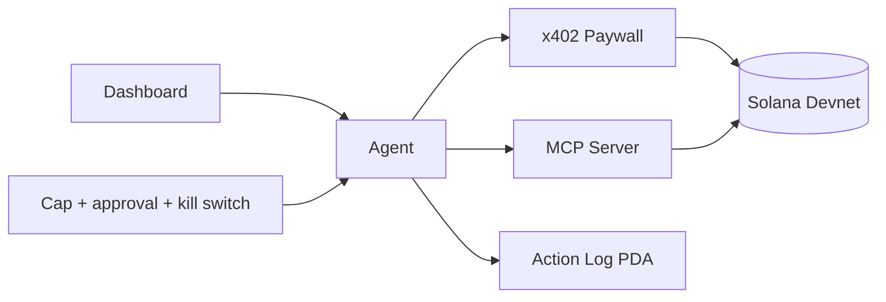

# Capstone

Chọn một trong các đề tài dưới đây và hoàn thiện toàn bộ hành trình từ đặc tả sản phẩm đến triển khai trên Devnet và demo công khai.

## Đề tài

### A. Ứng dụng chứng nhận học tập — Cốt lõi

- quản trị viên phát hành chứng nhận;
- credential/certificate PDA cho từng học viên hoặc thành tích;
- vòng đời phát hành và thu hồi;
- biểu diễn dưới dạng NFT hoặc token có thể xác minh;
- trang xác minh công khai.

### B. Ứng dụng điểm thưởng sự kiện — Cốt lõi

- check-in QR có chữ ký hoặc được server cấp quyền;
- account lưu điểm của người tham gia;
- danh mục phần thưởng và quy trình đổi thưởng;
- check-in có khả năng chống replay;
- dashboard quản trị.

### C. Truy cập khóa học bằng token — Cốt lõi

- yêu cầu sở hữu token hoặc số dư tối thiểu;
- quyền truy cập và mở khóa nội dung;
- mô phỏng thanh toán hoặc voucher;
- trạng thái truy cập trên frontend;
- quy tắc thu hồi và hết hạn rõ ràng.

### D. Escrow Marketplace Lite — Cốt lõi

- người bán đăng sản phẩm;
- người mua đặt cọc;
- người bán đánh dấu đã hoàn thành;
- người mua xác nhận;
- giả định rõ ràng về hủy, hoàn tiền và tranh chấp;
- frontend marketplace.

### E. AI Agent + Paywall dApp — AI/Agent

Yêu cầu đã hoàn thành các module x402, MCP và AI Agent.

- MCP server có công cụ đọc số dư, tài sản và công cụ ghi bị giới hạn;
- data endpoint được bảo vệ bằng x402;
- vòng lặp nhận biết, quyết định và thực thi của agent;
- spending-cap PDA, approval gate và kill switch;
- action-log PDA;
- dashboard hiển thị trạng thái, số dư, log và quyền can thiệp thủ công.

## Sản phẩm cần nộp

- repository chứa source hoàn chỉnh;
- sơ đồ kiến trúc, quan hệ account, instruction flow, PDA và client flow;
- source program có chú thích ở những phần quan trọng;
- test suite gồm happy path và error path;
- frontend đã deploy;
- Devnet program ID công khai và transaction mẫu;
- video demo dài 3–5 phút;
- security checklist đã hoàn thành;
- README hướng dẫn setup, test, deploy, known limitations và threat model.

## Tiêu chí đánh giá

| Tiêu chí | Trọng số | Minh chứng hoàn thành |
| --- | ---: | --- |
| Sản phẩm và demo | 15% | Use case mạch lạc và luồng công khai hoạt động |
| Tính đúng của program | 20% | Đủ instruction và state transition bắt buộc |
| Thiết kế account/PDA | 10% | Sơ đồ, seeds, ownership và authority |
| Kiểm thử | 15% | Happy path, authorization, account không hợp lệ và boundary case |
| Bảo mật | 15% | Checklist, threat model và adversarial test |
| Frontend/client | 10% | UX transaction và lỗi rõ ràng |
| Devnet/vận hành | 5% | Program ID, quy trình deploy tái lập được và kế hoạch giám sát |
| Tài liệu | 10% | Setup, sơ đồ, chú thích, demo và giới hạn |

## Các vòng review

### Vòng 1 — Đề xuất

Trình bày vấn đề, người dùng mục tiêu, đề tài đã chọn, phạm vi không làm, state account, danh sách instruction và rủi ro.

### Vòng 2 — Review thiết kế

Chuẩn bị sơ đồ account/PDA, bảng account của instruction, frontend flow, kế hoạch kiểm thử và giả định bảo mật.

### Vòng 3 — Review program

Các instruction cốt lõi phải vượt qua local test; trình bày được error case và kiểm tra authorization.

### Vòng 4 — Review phát hành

Hoàn thành triển khai Devnet, frontend, bằng chứng trên Explorer, security checklist và buổi chạy thử demo.

Quay lại [chương trình học](../curriculum/README.md) hoặc [trang chính](../README.md).
