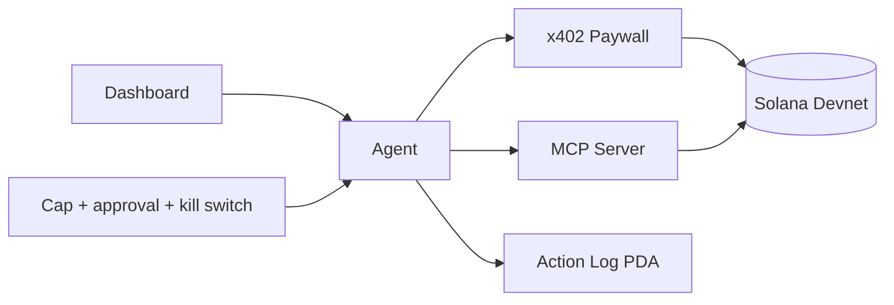

# Capstone project

Learners choose one option and demonstrate a complete path from product specification to Devnet deployment and public demo.

## Options

### A. Campus Credential App — Core

- admin issuer;
- credential/certificate PDA per learner or achievement;
- issue and revoke lifecycle;
- NFT or verifiable token representation;
- public verification page.

### B. Event Reward / Loyalty App — Core

- signed or server-authorized QR check-in;
- participant points account;
- reward catalogue and redemption;
- replay-resistant check-ins;
- admin dashboard.

### C. Token-Gated Course Access — Core

- token ownership or balance requirement;
- course entitlement/unlock;
- payment or voucher simulation;
- frontend access state;
- clear revocation/expiry behavior.

### D. Escrow Marketplace Lite — Core

- seller listing;
- buyer deposit;
- seller fulfillment marker;
- buyer confirmation;
- cancel/refund/dispute assumptions;
- marketplace frontend.

### E. AI Agent + Paywall dApp — AI/Agent

Requires x402, MCP, and AI Agent modules.

- MCP server with balance, holdings, and constrained write tools;
- x402-gated data endpoint;
- agent perception/decision/execution loop;
- spending-cap PDA, approval gate, and kill switch;
- action-log PDA;
- dashboard for status, balance, logs, and manual override.

## Required deliverables

- complete source repository;
- architecture, account relationship, instruction-flow, PDA, and client-flow diagrams;
- commented smart contract source;
- test suite with happy and error cases;
- deployed frontend;
- public Devnet program ID and transaction examples;
- 3-5 minute demo video;
- completed security checklist;
- README with setup, test, deploy, known limitations, and threat model.

## Capstone rubric

| Dimension | Weight | Completion evidence |
| --- | ---: | --- |
| Product and demo | 15% | Coherent use case and working public flow |
| Program correctness | 20% | Required instructions and state transitions |
| Account/PDA design | 10% | Diagrams, seeds, ownership, authority |
| Tests | 15% | Happy, authorization, invalid-account, boundary cases |
| Security | 15% | Checklist, threat model, adversarial tests |
| Frontend/client | 10% | Clear transaction and error UX |
| Devnet/operations | 5% | Program ID, reproducible deployment, monitoring plan |
| Documentation | 10% | Setup, diagrams, comments, demo, limitations |

## Review gates

### Gate 1 — Proposal

Problem, target user, option, non-goals, state accounts, instruction list, and risks.

### Gate 2 — Design review

Account/PDA diagrams, instruction account tables, frontend flow, test plan, and security assumptions.

### Gate 3 — Program review

Core instructions pass local tests; error cases and authorization checks are demonstrated.

### Gate 4 — Launch review

Devnet deployment, frontend, explorer evidence, completed security checklist, and demo rehearsal.
