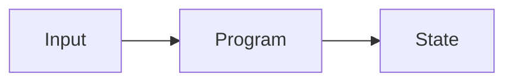

# Lesson X.Y: Title

## Kết quả đầu ra

One observable capability the learner will demonstrate.

## Prerequisites

- Required earlier lesson or concept

## Concept

Giải thích ý tưởng bằng ngôn ngữ đơn giản và nói rõ nó không phải là gì.

## Schema

## Code-along

1. Start from a named repository state.
2. Make one meaningful change at a time.
3. Predict the result before running it.

## Test

- Happy path
- Authorization failure
- Invalid account or input
- Boundary case

## Lab

Describe the learner-owned extension without revealing the final implementation.

## Exit ticket

- What changed?
- Who authorized it?
- Which invariant was enforced?
