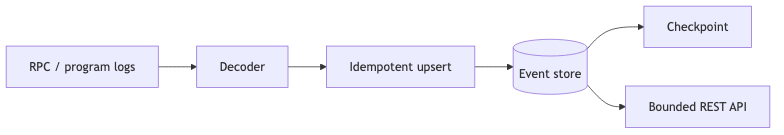

# Data Indexing Lab

Lab ingest event Voting theo khóa idempotency `(signature, logIndex)`, giữ checkpoint và cung cấp pagination giới hạn. Dùng fixture local nên không cần RPC/PostgreSQL để học core invariant.

[Mermaid source](../../notes/images/indexing-flow.mmd)

Bắt đầu tại [starter](./starter/src/indexer.ts), đối chiếu [solution](./solution/src/indexer.ts).
