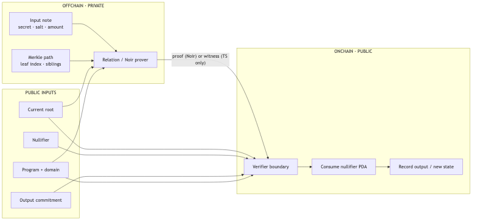
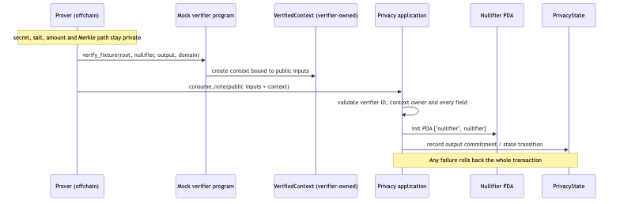

# Privacy & ZK Lab — ba tầng

Lab dùng một private-note spend xuyên suốt:

```text
input note → commitment membership → nullifier → output commitment
```



[Mermaid source của data flow](../../notes/images/privacy-flow.mmd) ·
[Mermaid source của Solana flow](../../notes/images/privacy-solana-flow.mmd)

## Điều quan trọng trước khi chạy

- TypeScript tầng 1 **nhìn thấy witness** và không phải zero-knowledge.
- Noir/Barretenberg tầng 2 tạo proof thật nhưng chỉ verify local trong module này.
- Mock verifier tầng 3 **không verify cryptographic proof**; deploy nó production sẽ cho phép
  tạo verified context mà không có ZK soundness.
- ZK ElGamal Proof Program hỗ trợ các proof type cụ thể của Solana/Token-2022, không phải generic
  Noir/Barretenberg verifier.

## Tầng 1 — TypeScript executable relation

Starter:

```bash
cd starter
pnpm install
pnpm test
pnpm run check
```

Các test starter được skip để học viên viết theo test matrix. Đối chiếu solution:

```bash
cd ../solution
pnpm install
pnpm test
pnpm run check
```

Solution kiểm tra commitment preimage, depth-2 Merkle membership, domain-bound nullifier, output
commitment, value conservation, replay và failed-verification atomicity. SHA-256 ở đây chỉ giúp
quan sát data flow; Noir dùng Pedersen hash nên hai tầng không dùng chung commitment bytes.

## Tầng 2 — Noir circuit và local proof

Khóa toolchain:

- `nargo 1.0.0-beta.20`
- `bb 3.0.0-nightly.20251104`

Cài bằng `noirup`/`bbup`, chọn đúng version rồi kiểm tra:

```bash
noirup -v 1.0.0-beta.20
bbup -v 3.0.0-nightly.20251104
nargo --version
bb --version
```

Chạy constraint tests:

```bash
cd solution/noir
nargo test
```

Circuit có test valid và các `should_fail` case cho secret, path, root, nullifier và inflation.
Để tạo proof cho fixture riêng:

```bash
cp Prover.example.toml Prover.toml
# Điền public fields được tính từ cùng private fixture.
nargo execute private_note
bb prove -b target/private_note.json -w target/private_note.gz --write_vk -o target
bb verify -p target/proof -k target/vk
```

Sau đó sửa proof hoặc public inputs và xác nhận verification bị từ chối. `Prover.toml`, witness,
proof, verification key và `target/` đã được ignore; không commit dữ liệu thật.

## Tầng 3 — Solana verifier boundary



Solution gồm `mock-verifier` và `privacy-app`. Program thứ hai khóa verifier ID, kiểm tra
verifier-owned context qua CPI, bind mọi public input, rồi tạo nullifier PDA và cập nhật state.

```bash
cd solution/solana
pnpm install
pnpm test
```

Script test sinh deterministic **local-only program deployment keys** vào ignored `target/`.
Các seeds là public fixtures, không phải wallet và không được tái sử dụng ngoài local validator.
Test matrix gồm valid consume, replay, mismatched public inputs, stale root/domain, fake verifier,
fake context owner và rollback sau CPI failure.

Chỉ compile Rust, không khởi động validator:

```bash
NO_DNA=1 cargo check --workspace
NO_DNA=1 anchor build
```

## Case study: Token-2022 Confidential Transfers

Token-2022 lưu public, pending encrypted và available encrypted balances. Client tạo encryption
keys/proof; ZK ElGamal Proof Program verify proof type được hỗ trợ thành context state account;
Token-2022 instruction tham chiếu context này để configure/transfer/withdraw.

Điểm giống lab là verifier-owned context và consumer bind lại public inputs. Điểm khác quyết định
là mock verifier không có cryptography, còn proof program của Solana chỉ hiểu protocol/proof types
của confidential transfers — nó không nhận arbitrary Noir proof.

- [Official confidential-transfer account flow](https://solana.com/docs/tokens/extensions/confidential-transfer/create-token-account)
- [Official Noir proving workflow](https://noir-lang.org/docs/getting_started_manually)

## Definition of done

- vẽ lại được hai diagram và đánh dấu public/private;
- toàn bộ TypeScript solution tests pass;
- `nargo test` và một lần `bb verify` pass;
- Anchor integration tests chứng minh invalid/replay rejection;
- điền [threat-model worksheet](../../curriculum/module-12-privacy-zk/threat-model.md);
- README nộp bài liệt kê metadata vẫn bị lộ và không gọi mock verifier là ZK.
