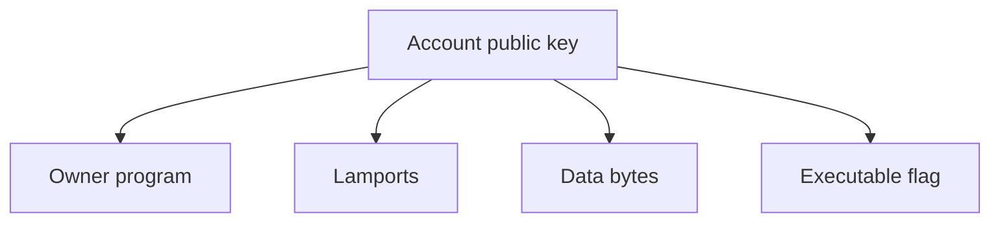

# Accounts

[Mở source Excalidraw](./images/account.excalidraw)

A Solana account is a record addressed by a public key.

## Program account vs data account

- A program account contains executable code.
- A data account contains serialized application state.
- Only the owner program may modify an account's data or debit its lamports.
- A transaction marks accounts as signer/non-signer and writable/read-only.

## Account review questions

1. Does the expected program own this account?
2. Must it be writable?
3. Must it sign?
4. Is its address constrained to the correct PDA or token account?
5. Is enough space allocated for its serialized data plus discriminator?
