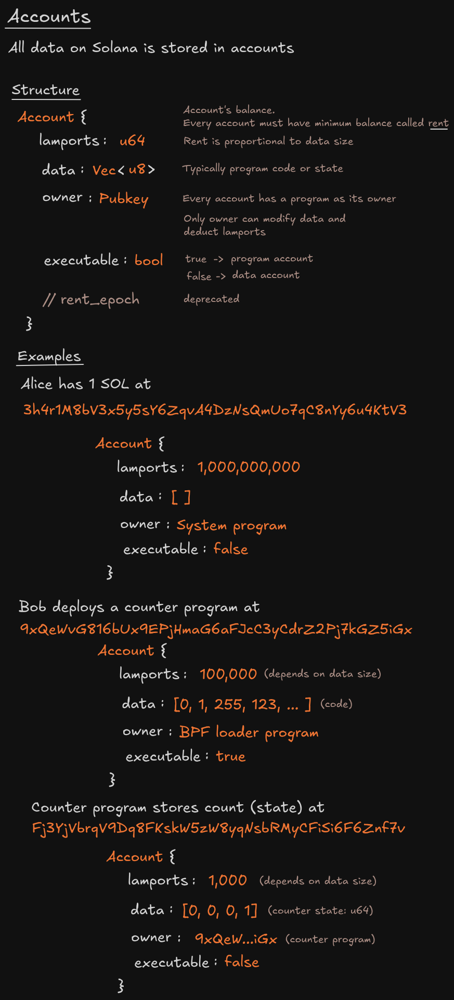
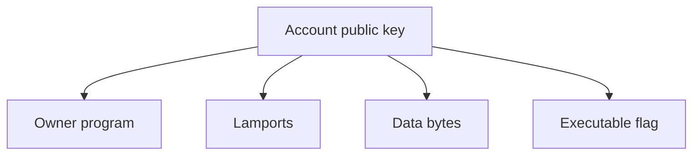

# Account trên Solana

Account trên Solana là một vùng dữ liệu được định danh bằng public key.

## Program account và data account

- Program account chứa code có thể thực thi.
- Data account chứa trạng thái ứng dụng đã được serialize.
- Chỉ owner program mới có thể sửa data hoặc trừ lamports của account.
- Transaction đánh dấu từng account là signer/non-signer và writable/read-only.

## Câu hỏi khi review account

1. Account có thuộc đúng program dự kiến không?
2. Account có cần writable không?
3. Account có cần ký không?
4. Địa chỉ có được ràng buộc đúng với PDA hoặc token account không?
5. Có đủ dung lượng cho dữ liệu đã serialize và discriminator không?

## Tài nguyên sơ đồ

[Mở bản Excalidraw](./images/account.excalidraw) để chỉnh sửa sơ đồ.
