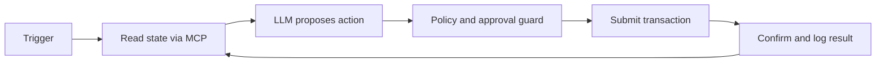

# AI agent trên Solana

## Cơ chế bảo vệ

- ví riêng cho agent;
- hạn mức chi tiêu theo action và theo ngày;
- allowlist program, instruction, mint và recipient;
- simulation trước khi gửi;
- giới hạn slippage và phí;
- yêu cầu con người phê duyệt khi vượt ngưỡng;
- kill switch và delegated authority có thể thu hồi;
- audit log bất biến cho action được đề xuất và đã thực thi.

Không bao giờ chuyển trực tiếp nội dung do model tạo thành transaction chưa được kiểm tra.

## Tài nguyên sơ đồ

[Mở Mermaid source](./images/agent-loop.mmd) để chỉnh sửa sơ đồ.
