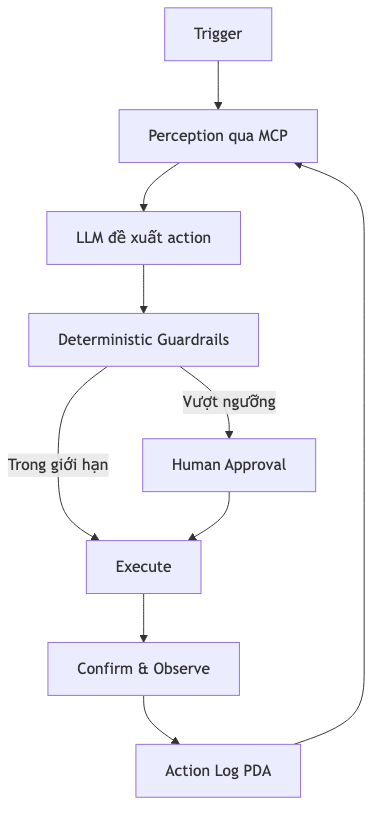
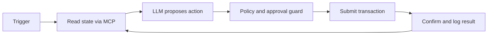

# AI agents on Solana

[Mermaid source](./images/agent-loop.mmd)

## Guardrails

- dedicated agent wallet;
- per-action and daily spending caps;
- allowlisted programs, instructions, mints, and recipients;
- simulation before send;
- slippage and fee limits;
- human approval above threshold;
- kill switch and revocable delegated authority;
- immutable audit log of proposed and executed actions.

Never let model-generated text become an unchecked transaction.
