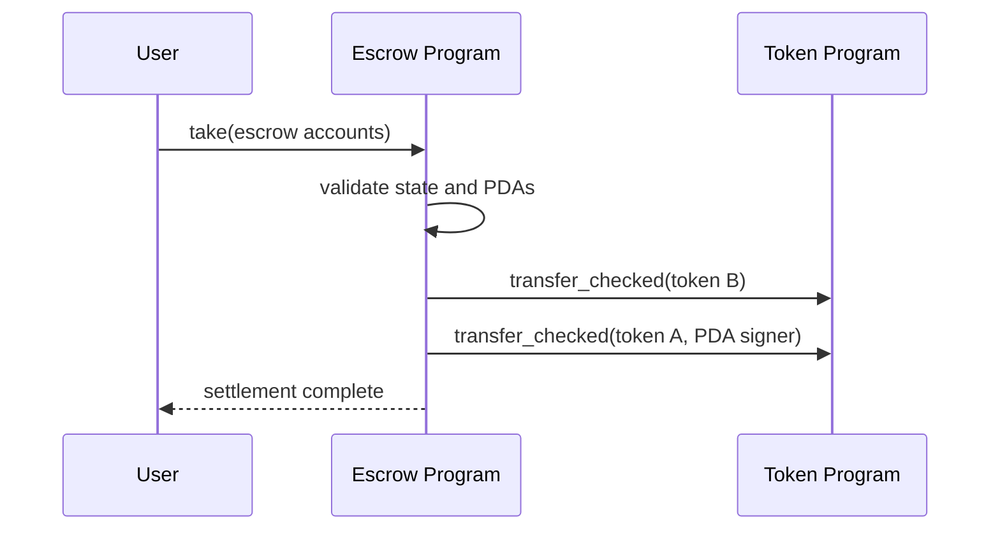

# Cross-program invocations

A CPI lets one Solana program invoke another.

The calling program must validate the target program, account relationships, token mints/owners, amounts, and signer seeds before invoking.
