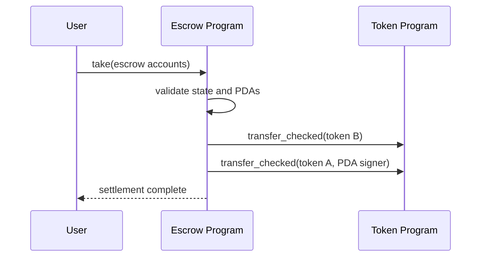

# Cross-program invocation (CPI)

CPI cho phép một Solana program gọi program khác.

Trước khi gọi CPI, program phải xác minh target program, quan hệ giữa các account, token mint/owner, số lượng và signer seeds.
