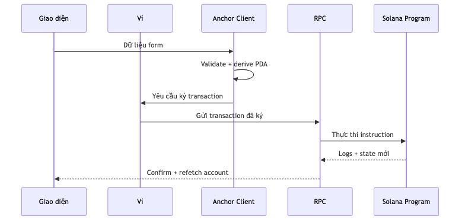
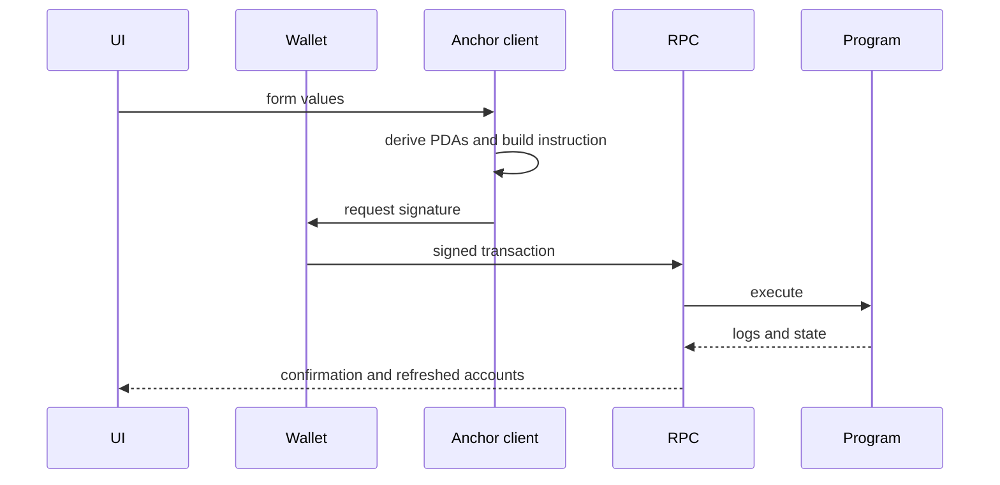

# Luồng dữ liệu từ frontend đến program

IDL mô tả tên instruction, arguments, accounts và account data. Tuy vậy, developer vẫn cần hiểu PDA, signer, confirmation, retry và cách xử lý lỗi.

## Tài nguyên sơ đồ

[Mở Mermaid source](./images/frontend-flow.mmd) để chỉnh sửa sơ đồ.
