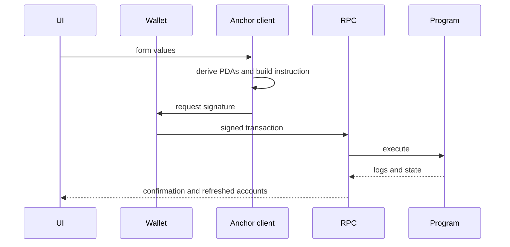

# Frontend-to-program data flow

[Mermaid source](./images/frontend-flow.mmd)

The IDL describes instruction names, arguments, accounts, and account data. It does not remove the need to understand PDAs, signers, confirmations, retries, or errors.
