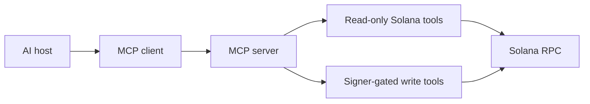

# Model Context Protocol

Tool cần có tên và mô tả rõ ràng, JSON Schema, kết quả có cấu trúc, lỗi dễ dự đoán và quyền hạn tối thiểu. Tách tool chỉ đọc khỏi các action tiêu tiền hoặc gửi transaction.

## Tài nguyên sơ đồ

[Mở Mermaid source](./images/mcp-architecture.mmd) để chỉnh sửa sơ đồ.
