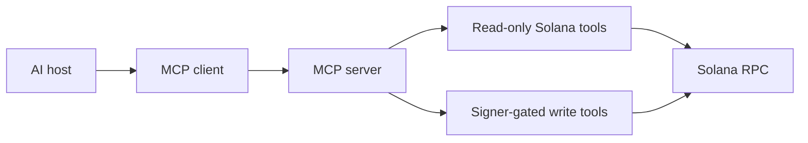

# Model Context Protocol

[Mermaid source](./images/mcp-architecture.mmd)

Tools need clear names, descriptions, JSON Schemas, structured results, predictable errors, and least-privilege authorization. Separate read-only tools from actions that spend funds or submit transactions.
