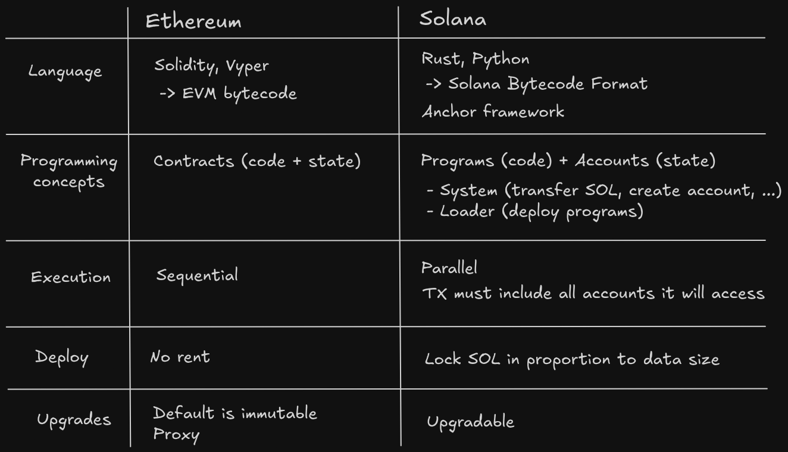

# Solana vs EVM

| Câu hỏi | Solana | EVM |
| --- | --- | --- |
| Trạng thái nằm ở đâu? | Các account riêng được truyền vào instruction | Storage của contract |
| Program code có lưu dữ liệu người dùng không? | Thường không; program chủ yếu chứa logic không trạng thái | Contract sở hữu storage của nó |
| Thực thi song song | Có thể khi quyền truy cập account không xung đột | Chủ yếu tuần tự trên từng chain |
| Đầu vào khi gọi | Program ID, account metas, instruction data | Target, calldata, value |
| Phân quyền | Signer flags kết hợp validation trong program | `msg.sender` kết hợp validation trong contract |

Thói quen quan trọng khi làm việc với Solana là luôn hỏi: “Account nào được đọc, account nào được ghi, ai sở hữu chúng và ai đã ký?”

## Tài nguyên sơ đồ

[Mở bản Excalidraw](./images/solana-vs-evm.excalidraw) để chỉnh sửa sơ đồ.
