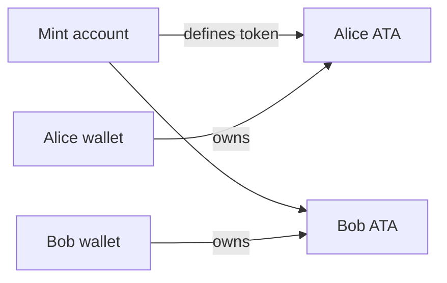

# SPL Token model

[Mở source Excalidraw](./images/spl-token.excalidraw)

- The mint defines decimals, supply, mint authority, and optional freeze authority.
- A token account stores a balance for one owner and one mint.
- An associated token account is the conventional token account derived from wallet and mint.
- Token transfers change token-account balances, not wallet account lamports.

Always validate mint equality, token-account authority, expected token program, and checked decimals.
