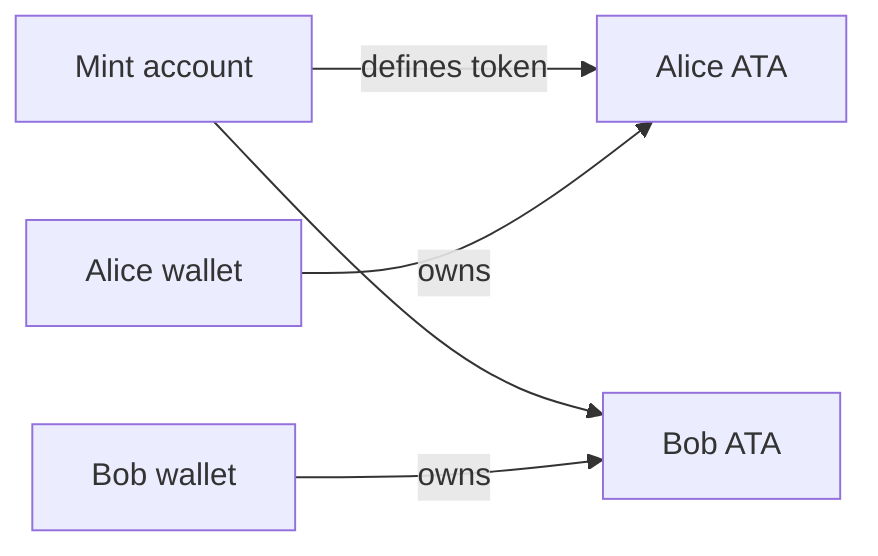

# Mô hình SPL Token

- Mint xác định decimals, supply, mint authority và freeze authority nếu có.
- Token account lưu số dư của một owner cho một mint.
- Associated token account là token account theo quy ước, được derive từ wallet và mint.
- Token transfer thay đổi số dư token account, không thay đổi lamports của wallet account.

Luôn xác minh đúng mint, authority của token account, token program dự kiến và decimals.
