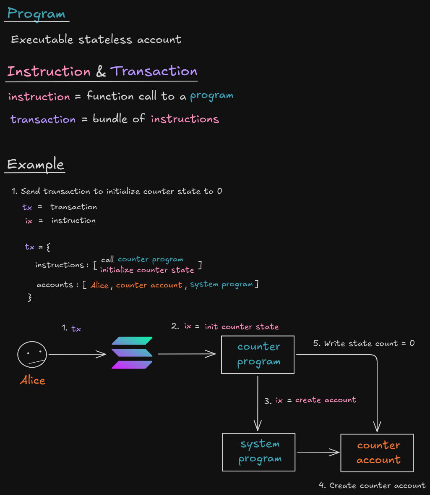
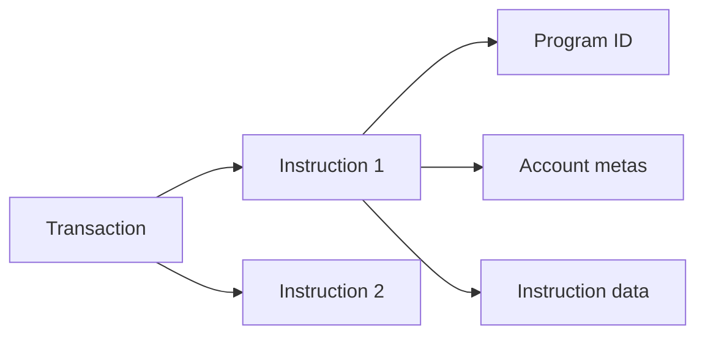

# Program, instruction và transaction

- Transaction là một gói nguyên tử đã được ký, chứa một hoặc nhiều instruction.
- Instruction xác định program, liệt kê account và cung cấp dữ liệu đã serialize.
- Runtime khóa các writable account, xác minh chữ ký và gọi program.
- Nếu một instruction thất bại, toàn bộ thay đổi trạng thái của transaction được rollback.

Trước khi gửi transaction, client cần recent blockhash, fee payer, các chữ ký bắt buộc và đầy đủ account của mọi instruction.

## Tài nguyên sơ đồ

[Mở bản Excalidraw](./images/program.excalidraw) để chỉnh sửa sơ đồ.
