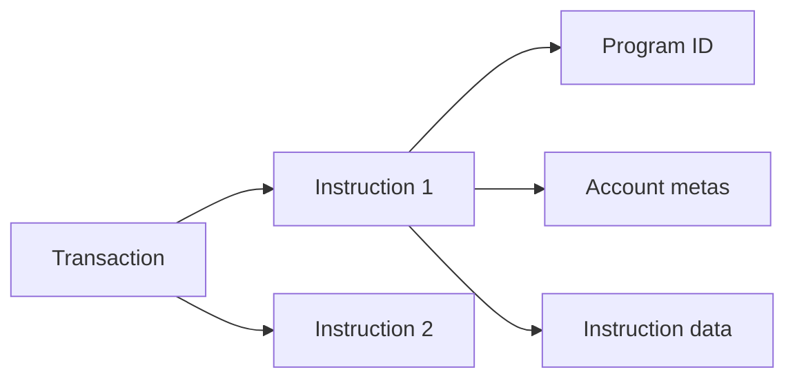

# Programs, instructions, and transactions

[Mở source Excalidraw](./images/program.excalidraw)

- A transaction is an atomic, signed envelope containing one or more instructions.
- An instruction identifies a program, lists accounts, and provides serialized data.
- The runtime locks writable accounts, verifies signatures, and invokes programs.
- If one instruction fails, the transaction's state changes roll back.

Before sending a transaction, a client needs a recent blockhash, fee payer, required signatures, and all instruction accounts.
