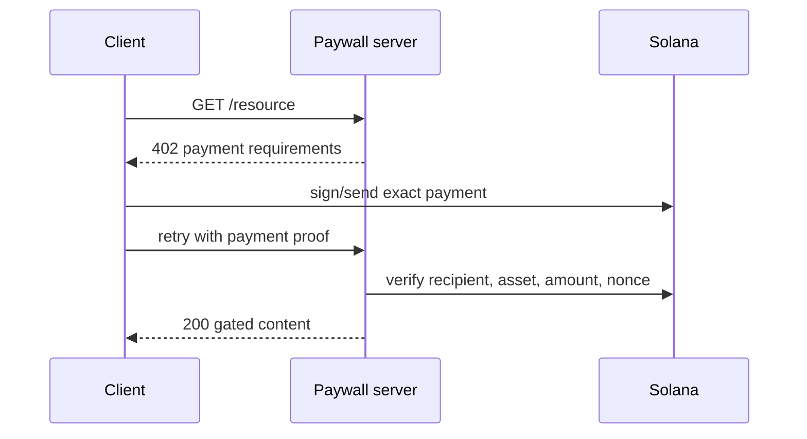

# x402 payment flow

[Mermaid source](./images/x402-flow.mmd)

Production concerns include replay prevention, expiry, exact asset/recipient validation, confirmation level, concurrent requests, idempotency, refunds, and rate limits.
