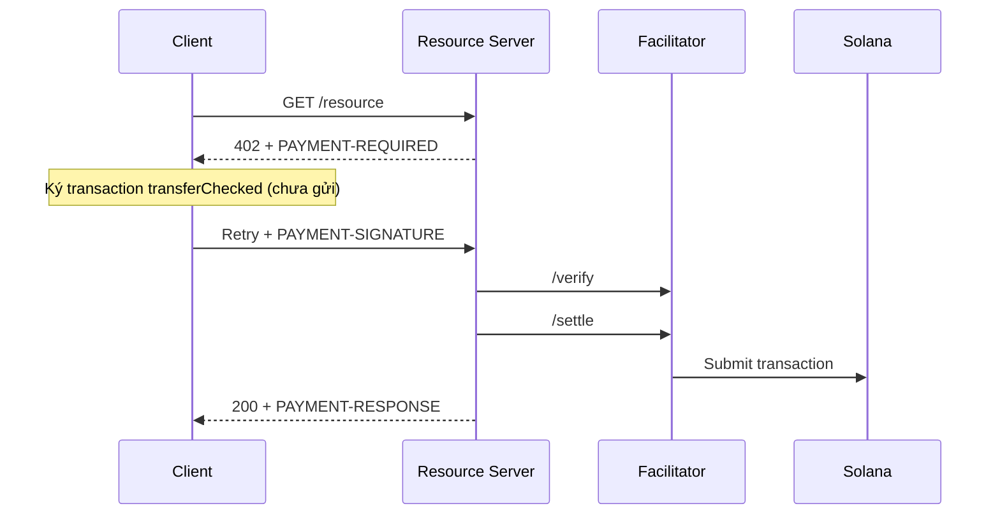

# Luồng thanh toán x402

x402 v2 dùng ba header, mỗi header là JSON mã hóa base64:

| Header | Chiều | Nội dung |
| --- | --- | --- |
| `PAYMENT-REQUIRED` | server → client | `PaymentRequired`: `x402Version`, `resource`, `accepts[]` |
| `PAYMENT-SIGNATURE` | client → server | `PaymentPayload`: `accepted` (option client chọn) + `payload.transaction` đã ký |
| `PAYMENT-RESPONSE` | server → client | `SettleResponse`: `success`, `transaction` (signature), `network`, `payer` |

Bản v1 dùng header `X-PAYMENT` và network kiểu `"solana-devnet"`; không dùng cho tích hợp mới. Network v2 theo CAIP-2: Devnet là `solana:EtWTRABZaYq6iMfeYKouRu166VU2xqa1`, Mainnet là `solana:5eykt4UsFv8P8NJdTREpY1vzqKqZKvdp`.

Điểm khác với cách "client tự gửi tx rồi đưa signature": client chỉ **ký**, còn **facilitator** verify (chữ ký, layout instruction, amount, mint, ATA người nhận, fee payer) rồi mới submit. Server có thể tự làm facilitator, khi đó phải giữ cache payload khoảng 120 giây để chặn settle trùng.

Khi đưa vào production, cần xử lý: so khớp `accepted` với option đã công bố, chống settle trùng, request đồng thời, timeout facilitator, ATA người nhận phải tồn tại sẵn, rate limit và log không lộ dữ liệu nhạy cảm.

Tài liệu gốc: [Solana docs: x402](https://solana.com/docs/payments/agentic-payments/x402) · [docs.x402.org](https://docs.x402.org).

## Tài nguyên sơ đồ

[Mở Mermaid source](./images/x402-flow.mmd) để chỉnh sửa sơ đồ.
