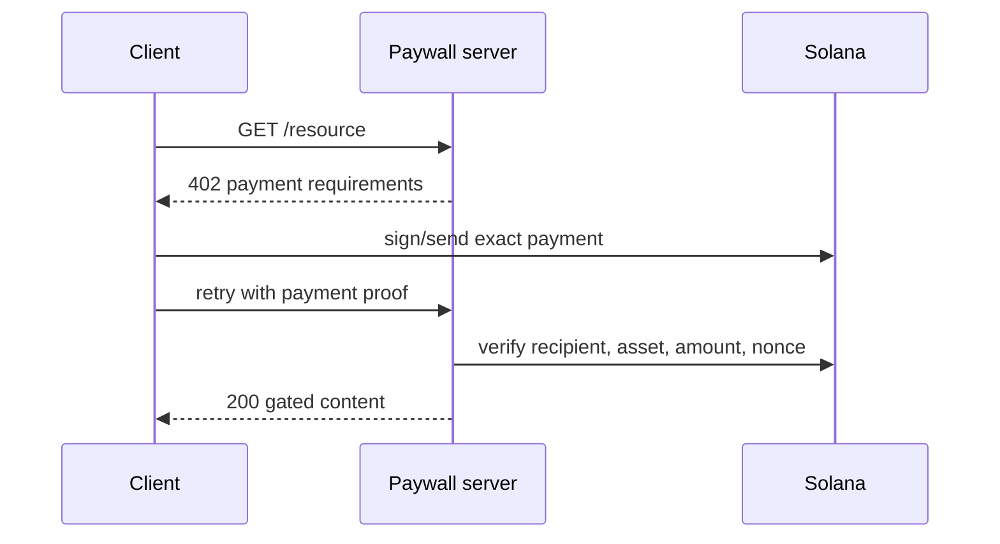

# Luồng thanh toán x402

Khi đưa vào production, cần xử lý chống replay, thời hạn thanh toán, xác minh chính xác asset/recipient, confirmation level, request đồng thời, idempotency, hoàn tiền và rate limit.

## Tài nguyên sơ đồ

[Mở Mermaid source](./images/x402-flow.mmd) để chỉnh sửa sơ đồ.
