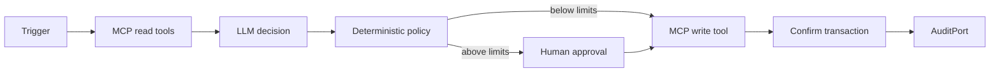

# AI Agent on Solana

Agent loop có thể audit: đọc state qua MCP, đề xuất action có giới hạn, xin approval khi cần, execute, confirm và ghi kết quả.

[Mermaid source](../../notes/images/agent-loop.mmd)

Mã nguồn: [starter](./starter/README.md) → [checkpoint 1](./checkpoint-1/README.md) → [checkpoint 2](./checkpoint-2/README.md) → [final](./final/README.md).

## Kiến trúc

## Khả năng bắt buộc

- report balances and selected onchain state;
- choose an allowlisted vote, transfer, or swap action;
- buy gated data through x402;
- enforce per-action/session spending limits;
- require human approval above threshold;
- support kill switch;
- ghi proposal, policy result và execution result qua `AuditPort`;
- handle simulation failure, blockhash expiry, RPC timeout, slippage, and rejected approval.

## Các trạng thái

- `starter`: deterministic loop shell and mock tools
- `checkpoint-1`: perception and structured proposals
- `checkpoint-2`: guarded execution and confirmations
- `final`: MCP/x402 adapters, audit log local, session limits, kill switch và red-team tests

## Red-team cases

- prompt injection asks for seed/private key;
- tool output embeds malicious instructions;
- hallucinated mint/program/recipient;
- repeated execution after timeout;
- wallet-draining amount or slippage;
- kill switch active;
- memory contains stale or conflicting state.

## Authority và mutable state

| Giai đoạn | Input authority | Mutable state/effect | Guardrail |
| --- | --- | --- | --- |
| observe | MCP read adapter | observation version | tool output là untrusted data |
| propose | deterministic/mock planner hoặc model adapter | chưa có external effect | typed proposal và target allowlist |
| approve | human/policy input | approval decision | threshold, kill switch, session cap |
| execute | MCP hoặc x402 adapter | transaction/payment | idempotency, stale-version check, limits |
| audit | `AuditPort` | append-only audit entries | ghi cả denied/failed/success result |

## State và trust boundary

Core dùng `AuditPort` để mock/local mode chạy không cần chain; bản `final` cung cấp `MemoryAuditStore`. Action Log PDA và dashboard là bài mở rộng production, chưa phải public artifact của project. Model chỉ sinh `Proposal`; deterministic policy và MCP/x402 adapters mới được phép execute. Tool output luôn là untrusted data.
