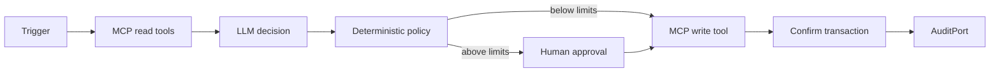

# AI Agent on Solana

Agent loop có thể audit: đọc state qua MCP, đề xuất action có giới hạn, xin approval khi cần, execute, confirm và ghi kết quả.

Mã nguồn: [starter](./starter/README.md) → [checkpoint 1](./checkpoint-1/README.md) → [checkpoint 2](./checkpoint-2/README.md) → [final](./final/README.md).

## Kiến trúc

## Khả năng bắt buộc

- báo cáo số dư và onchain state đã chọn;
- chọn action vote, transfer hoặc swap trong allowlist;
- mua dữ liệu được bảo vệ qua x402;
- áp dụng hạn mức chi tiêu theo action/session;
- yêu cầu con người phê duyệt khi vượt ngưỡng;
- hỗ trợ kill switch;
- ghi proposal, policy result và execution result qua `AuditPort`;
- xử lý simulation failure, blockhash hết hạn, RPC timeout, slippage và approval bị từ chối.

## Các trạng thái

- `starter`: deterministic loop shell và mock tool
- `checkpoint-1`: perception và proposal có cấu trúc
- `checkpoint-2`: guarded execution và confirmation
- `final`: MCP/x402 adapter, audit log local, session limit, kill switch và red-team test

## Red-team cases

- prompt injection yêu cầu seed/private key;
- tool output chứa instruction độc hại;
- model bịa mint/program/recipient;
- thực thi lặp lại sau timeout;
- amount hoặc slippage có thể rút cạn ví;
- kill switch đang bật;
- memory chứa state cũ hoặc xung đột.

## Authority và mutable state

| Giai đoạn | Input authority | Mutable state/effect | Guardrail |
| --- | --- | --- | --- |
| observe | MCP read adapter | observation version | tool output là untrusted data |
| propose | deterministic/mock planner hoặc model adapter | chưa có external effect | typed proposal và target allowlist |
| approve | human/policy input | approval decision | threshold, kill switch, session cap |
| execute | MCP hoặc x402 adapter | transaction/payment | idempotency, stale-version check, limits |
| audit | `AuditPort` | append-only audit entries | ghi cả denied/failed/success result |

## State và trust boundary

Core dùng `AuditPort` để mock/local mode chạy không cần chain; bản `final` cung cấp `MemoryAuditStore`. Action Log PDA và dashboard là bài mở rộng production, chưa phải public artifact của project. Model chỉ sinh `Proposal`; deterministic policy và MCP/x402 adapters mới được phép execute. Tool output luôn là untrusted data.

## Tài nguyên sơ đồ

[Mở Mermaid source](../../notes/images/agent-loop.mmd) để chỉnh sửa sơ đồ.
