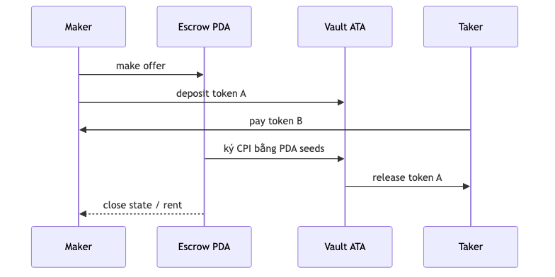
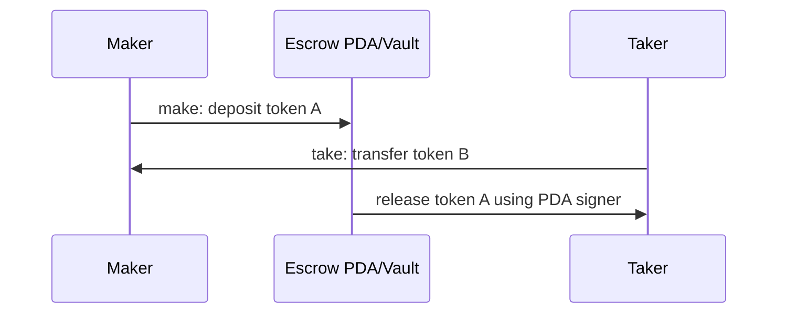

# Escrow

Maker khóa token A; taker trả token B; program settlement nguyên tử hoặc maker refund trước khi offer được nhận.

> Mã nguồn đã đủ bốn trạng thái: [starter](./starter/README.md) → [checkpoint 1](./checkpoint-1/README.md) → [checkpoint 2](./checkpoint-2/README.md) → [final](./final/README.md).

## Mô hình state

| Account | PDA seeds | Key fields |
| --- | --- | --- |
| Escrow | `['escrow', maker, seed]` | maker, mints, amounts, bump |
| Vault ATA | ATA of escrow PDA and mint A | deposited token A |

## Instructions

| Instruction | Preconditions | Result |
| --- | --- | --- |
| `make` | maker signs; valid mints/amounts | State + funded vault |
| `take` | correct state, mints, ATAs, amount | Atomic exchange and close |
| `refund` | maker signs; unsettled | Return token A and close |

## Signer, writable và owner

| Write path | Signer | State mutable | Owner/authority |
| --- | --- | --- | --- |
| `make` | maker | Escrow, vault, maker token A | Escrow Program sở hữu state; Token Program sở hữu token accounts |
| `take` | taker | Escrow, vault, maker/taker token accounts | Escrow PDA ký release token A |
| `refund` | maker | Escrow, vault, maker token A | Escrow PDA ký hoàn token và đóng state |

## Các trạng thái

- `starter`: account structs, constraints và handler còn TODO
- `checkpoint-1`: `make` và nạp vault
- `checkpoint-2`: settlement bằng `take`
- `final`: `refund`, PDA signer và đóng account

## Test bảo mật cần có

- sai maker, mint, vault, token owner hoặc token program;
- thay thế receive account;
- nhiều account alias trỏ đến cùng địa chỉ;
- PDA signer seeds không chính xác;
- gọi `take` hoặc `refund` sau khi account đã đóng;
- số lượng bằng không hoặc không khớp.

## Tài nguyên sơ đồ

[Mở Mermaid source](../../notes/images/escrow-flow.mmd) để chỉnh sửa sơ đồ.
