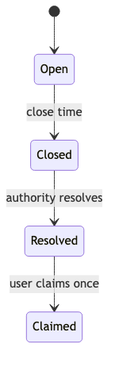
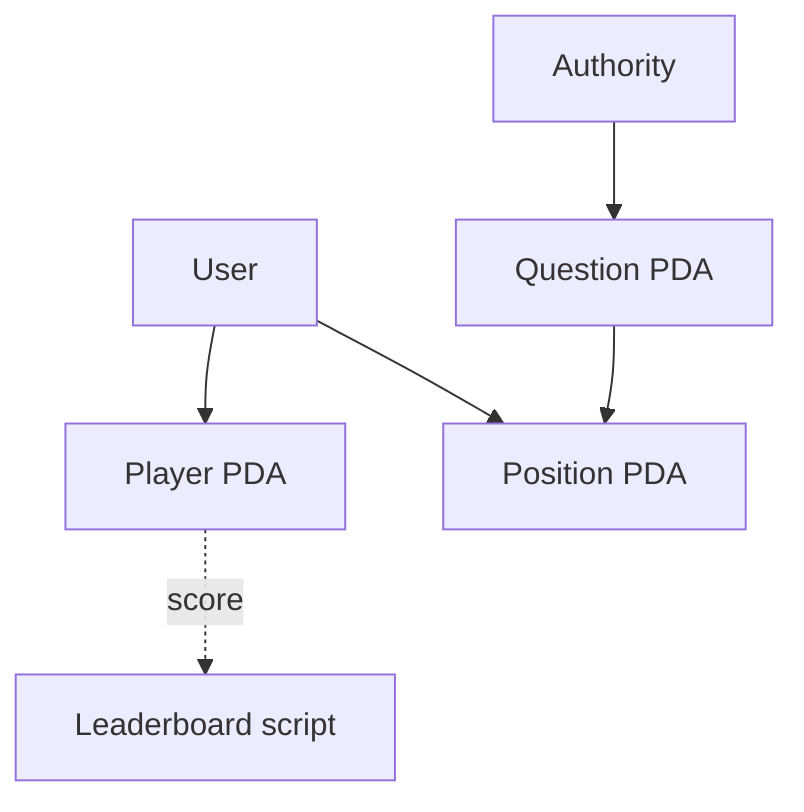

# Forecasting App

> **Điểm giả lập — không phải tiền thật.** Không có token, deposit, withdrawal, odds hay cơ chế cá cược. Điểm không đổi được thành tài sản nào.

Authority tạo câu hỏi có giờ đóng và 2–4 lựa chọn. Người chơi đăng ký nhận 1000 điểm giả lập, khóa một phần điểm vào một dự đoán trước giờ đóng. Sau giờ đóng, authority resolve đúng một lần; người chơi claim một lần để nhận lại điểm đã khóa và cộng `score` nếu đoán đúng. Leaderboard xếp hạng theo `score` đọc từ chain.

Bài gõ từng bước: [code-along Module 14](../../curriculum/module-14-forecasting/code-along.md).

## Mô hình state

| Account | PDA seeds | Key fields |
| --- | --- | --- |
| Question | `['question', authority, question_id]` | authority, text (≤ 120 bytes), outcomes (2–4, mỗi cái ≤ 24 bytes), close_time, resolved_outcome, participant_count |
| Player | `['player', user]` | user, points (ngân sách điểm đang rảnh), score (điểm thành tích) |
| Position | `['position', question, user]` | question, user, choice, points đã khóa, claimed |

## State machine

`Open → Closed → Resolved`. `Closed` suy ra từ `close_time` và `Clock`, không lưu riêng; `Resolved` là `resolved_outcome = Some(i)`.

| Instruction | Trạng thái hợp lệ | Lỗi khi sai |
| --- | --- | --- |
| `predict` | Open (`now < close_time`) | `QuestionClosed` |
| `resolve` | Closed, chưa resolve | `QuestionStillOpen`, `AlreadyResolved` |
| `claim` | Resolved, Position chưa claim | `NotResolved`, `AlreadyClaimed` |

## Instructions

| Instruction | Signer | Important validation |
| --- | --- | --- |
| `create_question` | authority | text không rỗng và ≤ 120 bytes; 2–4 lựa chọn, mỗi cái ≤ 24 bytes; `close_time > now` |
| `register_player` | user | `init` Player PDA: mỗi ví một sổ điểm, không tự cấp lại điểm |
| `predict` | user | trước giờ đóng; `choice < outcomes.len()`; `points > 0`; `checked_sub` trên `points`; `init` Position: một dự đoán mỗi câu hỏi |
| `resolve` | authority | `has_one = authority`; sau giờ đóng; đúng một lần; outcome hợp lệ |
| `claim` | user | đã resolve; `claimed == false`; seeds buộc Position và Player thuộc đúng ví |

## Signer, writable và owner

| Write path | Signer | State mutable | Owner/relationship |
| --- | --- | --- | --- |
| `create_question` | authority | Question (init) | Forecasting Program; PDA theo authority + question_id |
| `register_player` | user | Player (init) | PDA theo user |
| `predict` | user | Question, Player, Position (init) | Player và Position derive từ user ký; Position theo question + user |
| `resolve` | authority | Question | `question.authority == authority` |
| `claim` | user | Player, Position | Player/Position derive từ user ký và question |

## Công thức điểm

- `predict(choice, points)`: `player.points -= points` (checked), Position lưu `points`.
- `claim()`: `player.points += position.points`; nếu `position.choice == resolved_outcome` thì `player.score += position.points`, sai thì cộng 0.

Điểm khóa luôn được trả lại, không ai mất điểm cho người khác: đây là ngân sách độ tự tin, không phải tiền cược.

## Leaderboard

`app/leaderboard.ts` sắp xếp theo `score` giảm dần, hòa thì theo địa chỉ ví tăng dần (so bằng `<`, không phụ thuộc locale), rồi chia trang. `app/show-leaderboard.ts` đọc mọi `Player` qua `program.account.player.all()` và in kèm dòng `ĐIỂM GIẢ LẬP — KHÔNG PHẢI TIỀN THẬT`. Chạy: `anchor run leaderboard --provider.cluster devnet`.

## Các trạng thái

- `starter`: state schema, `CreateQuestion` và lỗi đầu tiên; test derive PDA và TODO
- `checkpoint-1`: `create_question` và 3 test (code-along bước 2)
- `checkpoint-2`: điểm giả lập, `predict`, `resolve` và 12 test (bước 4)
- `final`: `claim`, leaderboard và 17 test (bước 6)

## Test matrix

| Test | Đường | Lỗi mong đợi |
| --- | --- | --- |
| tạo câu hỏi đúng PDA | happy | — |
| giờ đóng đã qua | error | `InvalidCloseTime` |
| một lựa chọn | error | `InvalidOutcomeCount` |
| đăng ký 1000 điểm | happy | — |
| dự đoán khóa điểm | happy | — |
| lựa chọn không tồn tại | error | `InvalidChoice` |
| quá số điểm | error | `NotEnoughPoints` |
| dự đoán lần hai | error | account `already in use` |
| ví lạ resolve | error | `Unauthorized` |
| resolve khi còn mở | error | `QuestionStillOpen` |
| claim trước resolve | error | `NotResolved` |
| dự đoán sau giờ đóng | error | `QuestionClosed` |
| resolve hai lần | error | `AlreadyResolved` |
| claim đúng công thức | happy | — |
| claim hai lần | error | `AlreadyClaimed` |
| leaderboard ổn định, chia trang | happy | — |

## Security assumptions và known limitations

- Authority là nguồn sự thật duy nhất cho kết quả; không có oracle hay tranh chấp. Giao diện phải hiển thị ai là authority.
- `close_time` dựa trên `Clock` của cluster, có thể lệch vài giây so với giờ thật.
- Leaderboard đọc `getProgramAccounts`: đủ cho bài học, không phân trang phía RPC; dữ liệu lớn cần indexer như Module 13.
- Không có instruction đóng account hay thu hồi rent.
- Chưa có frontend; bản nộp cần thêm giao diện có disclaimer nổi bật theo lesson 14.8.

## Tài nguyên sơ đồ

[Mở Mermaid source](../../notes/images/forecasting-flow.mmd) để chỉnh sửa sơ đồ.
