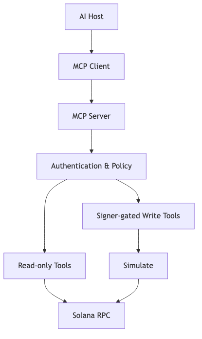
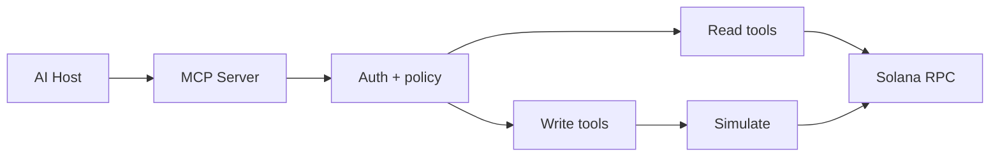

# MCP Solana Server

Cung cấp các Solana tool có cấu trúc và áp dụng nguyên tắc quyền hạn tối thiểu cho AI host.

Mã nguồn: [starter](./starter/README.md) → [checkpoint 1](./checkpoint-1/README.md) → [checkpoint 2](./checkpoint-2/README.md) → [final](./final/README.md).

## Danh mục tool

| Tool | Access | Guardrail |
| --- | --- | --- |
| `get_account_balance` | Read | Public key validation and RPC timeout |
| `get_token_holdings` | Read | Bounded results and known token program |
| `send_sol` | Write | Dedicated wallet, recipient allowlist, spending cap |
| `call_program` | Write | Program/instruction allowlist, typed accounts, simulation |

## Interface đã triển khai

- stdio transport dùng MCP SDK v1;
- bốn tool trong bảng trên với Zod input schema;
- kết quả success/error có cấu trúc;
- `RpcPort` có thể inject để test không cần Devnet hay private key.

MCP resources, reusable prompts và HTTP transport là bài mở rộng sau khi hoàn thành stdio server; chúng không nằm trong public interface của bản `final` hiện tại.

## Các trạng thái

- `starter`: core shell và tool schema tối thiểu
- `checkpoint-1`: read tools với injectable RPC
- `checkpoint-2`: write tools có authorization, policy và simulation
- `final`: stdio server, bốn tool, limits, structured errors và mock-client tests

## Test bắt buộc

Kiểm thử schema, RPC failure, cấu trúc kết quả đọc, write không có quyền, vượt cap, program/recipient ngoài allowlist, simulation failure và write thành công bằng mock RPC.

## Authority và mutable state

| Tool | Authority | Mutable state/external effect | Policy trước execution |
| --- | --- | --- | --- |
| `get_account_balance` | không cần signer | không có | public key hợp lệ, RPC timeout |
| `get_token_holdings` | không cần signer | không có | public key và bounded limit |
| `send_sol` | quyền ghi do server cấp (`AuthPort`) | recipient balance/transaction | recipient allowlist, per-action cap, confirmation |
| `call_program` | quyền ghi do server cấp (`AuthPort`) | chỉ simulation trong core hiện tại | program allowlist, instruction schema, simulation |

## Quyền ghi nằm ở đâu

Quyền ghi là **config của server**, không phải tham số của tool. `SolanaTools` nhận một `AuthPort` lúc khởi tạo; bản `final` bật quyền ghi bằng biến môi trường `SOLANA_MCP_WRITE_ENABLED=true` do người cấu hình host đặt.

Anti-pattern cần tránh: khai báo `authorized: z.boolean()` trong `inputSchema`. Model điền mọi field trong schema, nên nó có thể tự gửi `authorized: true` và bỏ qua toàn bộ guardrail. Mọi thứ model gửi lên đều là untrusted input.

## PDA rationale và trust boundary

MCP server không tạo PDA riêng; nó đọc/call các program đã allowlist. Host/model không giữ signer trực tiếp: mọi write đi qua authentication, policy, simulation và confirmation trong server.

## Tài nguyên sơ đồ

[Mở Mermaid source](../../notes/images/mcp-architecture.mmd) để chỉnh sửa sơ đồ.
