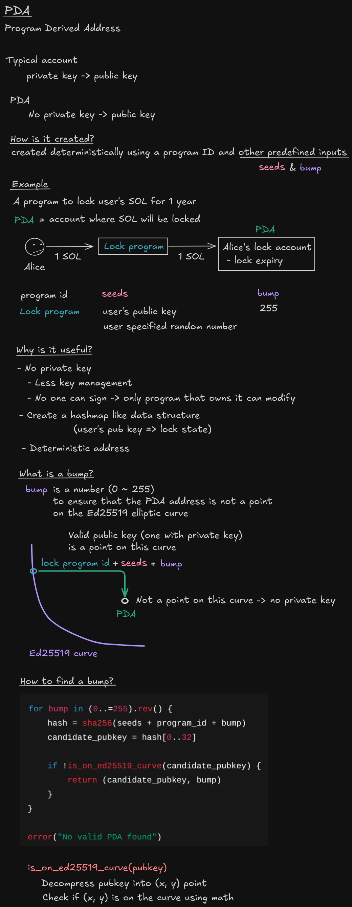
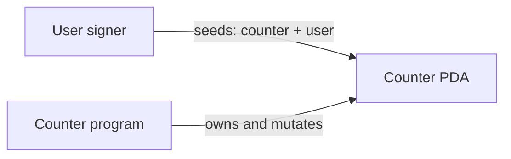

# PDA Counter

[Excalidraw source](../../notes/images/pda.excalidraw)

Project Anchor có state đầu tiên. Mỗi ví sở hữu một counter deterministic.

## Kết quả học tập

- derive và kiểm tra PDA theo từng người dùng;
- cấp đúng account space trong Anchor;
- chỉ cho signer hợp lệ thay đổi state;
- kiểm tra custom error và constraint error.

## State và authority

| Account | Seeds | Fields | Authority |
| --- | --- | --- | --- |
| Counter | `['counter', user]` | `owner`, `value`, `bump` | `owner` signer |

## Instruction contract

| Instruction | Preconditions | State change |
| --- | --- | --- |
| `initialize` | Counter chưa tồn tại; owner ký | Tạo counter có giá trị `0` |
| `increment` | Đúng owner/PDA | Cộng một bằng checked math |
| `decrement` | Giá trị lớn hơn `0` | Trừ một |
| `reset` | Đúng owner | Đưa giá trị về `0` |

## Các trạng thái

- `starter`: Anchor workspace, handler và test cần hoàn thiện
- `checkpoint-1`: initialize và kiểm thử PDA
- `checkpoint-2`: increment/decrement cùng error cases
- `final`: reset, bộ test đầy đủ, sơ đồ và hướng dẫn Devnet

## Test bắt buộc

- khởi tạo tại đúng PDA;
- từ chối khởi tạo trùng;
- increment/decrement/reset đúng;
- từ chối signer khác;
- ngăn underflow.
