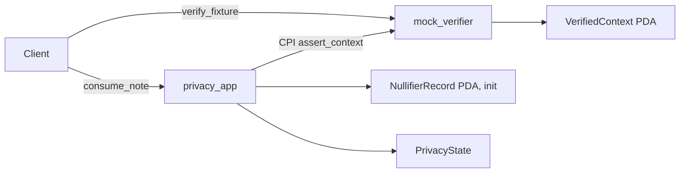

# Private Note

Alice tiêu một private note 10 đơn vị và tạo note mới 10 đơn vị. Project biểu diễn cùng một
statement ở ba tầng, mỗi tầng một thư mục trong `final/`:

| Thư mục | Tầng | Kiểm tra | Bảo đảm gì |
| --- | --- | --- | --- |
| `relation` | TypeScript executable relation | `pnpm test` (15 test), `pnpm run check` | Spec chạy được; verifier **thấy witness**, không phải ZK |
| `circuit` | Noir circuit + Barretenberg | `nargo test` (7 test), `bb verify` | Proof thật, verify local |
| `privacy-app` | Anchor: `mock_verifier` + `privacy_app` | `anchor test` (4 test) | Account/CPI boundary; mock verifier **không** có soundness |

Học theo [code-along Module 12](../../curriculum/module-12-privacy-zk/code-along.md): tạo từng
tầng từ thư mục trống và gõ lại toàn bộ code. `final/` chỉ để đối chiếu; project này không có
`starter` hay checkpoint.

## Statement

```text
note = { secret, salt, amount }
commitment = H("note", secret, salt, amount)
nullifier  = H("nullifier", secret, leaf_index, domain)
```

| Nhóm | Dữ liệu |
| --- | --- |
| Private witness | secret, salt, amount, leaf index, Merkle siblings, output secret/salt/amount |
| Public inputs | current root, nullifier, output commitment, domain |
| Constraints | commitment ∈ root, nullifier từ cùng secret, amount bảo toàn, output commitment đúng |

## Account (tầng `privacy-app`)

| Account | Owner | PDA seeds | Key fields |
| --- | --- | --- | --- |
| `VerifiedContext` | `mock_verifier` | `['verified', authority, nullifier]` | authority, root, nullifier, output commitment, domain |
| `PrivacyState` | `privacy_app` | `['state', authority]` | domain, current root, latest output, outputs count |
| `NullifierRecord` | `privacy_app` | `['nullifier', state, nullifier]` | state, nullifier |



## Instructions

| Instruction | Signer | Kiểm tra quan trọng |
| --- | --- | --- |
| `mock_verifier::verify_fixture` | authority | Không kiểm tra proof (chỉ để học) |
| `mock_verifier::assert_context` | authority | Context đúng owner, authority và từng public input |
| `privacy_app::initialize_state` | authority | domain/root khác 0 |
| `privacy_app::consume_note` | authority | root hiện hành, domain, verifier ID cố định, CPI thành công, nullifier PDA chưa tồn tại |

## Test matrix

| Tầng | Đường đúng | Đường lỗi |
| --- | --- | --- |
| relation | commitment, membership, spend hợp lệ, consume một lần | sai secret/salt/amount/path/root/domain, inflation, replay, stale root, không đổi state khi lỗi |
| circuit | witness hợp lệ | sai secret, path, root, nullifier, inflation; proof bị sửa |
| privacy-app | consume một lần | replay, public input lệch + rollback, stale root, domain khác, verifier giả, context giả |

## Giới hạn và giả định bảo mật

- Mock verifier tạo `VerifiedContext` mà không kiểm tra proof; deploy nó ngoài localnet là lỗ hổng.
- TypeScript dùng SHA-256, Noir dùng Pedersen: hai tầng cùng relation nhưng không chung hash.
- Fee payer, timing, program ID và kích thước transaction vẫn public; xem
  [threat-model worksheet](../../curriculum/module-12-privacy-zk/threat-model.md).
- `Prover.toml`, witness, proof và verification key không được commit.

Quay lại [danh sách project](../README.md).
