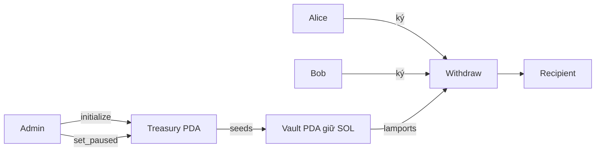

# Secure Treasury

Quỹ SOL của nhóm cho Module 18. Admin tạo quỹ với ba approver; mỗi lần rút cần chữ ký của hai approver khác nhau; admin có công tắc tạm dừng. Bài học đi theo nhịp đỏ rồi xanh: viết bản ngây thơ, viết test tấn công cho thấy lỗ hổng, vá program, giữ test làm regression.

Bài viết từng bước: [Module 18 code-along](../../curriculum/module-18-security/code-along.md).

## Product brief

- Người dùng: một nhóm nhỏ giữ chung một quỹ SOL trên Devnet.
- Phạm vi: tạo quỹ, rút 2-trên-3, tạm dừng khẩn cấp, client gửi giao dịch có compute budget và retry theo blockhash.
- Non-goals: đổi approver, chuyển quyền admin, token SPL, governance. Production nên dùng multisig đã audit như Squads thay vì tự viết.

## Mô hình state

| Account | PDA seeds | Fields | Authority/policy |
| --- | --- | --- | --- |
| Treasury | `['treasury', admin]` | admin, approvers `[Pubkey; 3]`, paused, bump, vault_bump | admin chỉ bật/tắt `paused` |
| Vault | `['vault', treasury]` | treasury; SOL là lamports của chính account | chỉ program rút, cần 2 approver khác nhau |

## Instructions

| Instruction | Signer | Mutable state | Preconditions | Kết quả |
| --- | --- | --- | --- | --- |
| `initialize(approvers)` | admin | Treasury, Vault (init) | PDA chưa tồn tại | Quỹ mở, `paused = false` |
| `withdraw(amount)` | approver_one, approver_two | Vault, recipient | không paused; cả hai là approver; khác nhau; vault đúng seeds; còn đủ rent | Chuyển `amount` lamports, log `withdraw … lamports to …` |
| `set_paused(paused)` | admin | Treasury | `treasury.admin == admin` | Đổi công tắc, log `paused = …` |

## Signer, writable và owner

| Write path | Signer | State mutable | Owner/relationship |
| --- | --- | --- | --- |
| `initialize` | admin (payer) | Treasury, Vault | Treasury Program; Vault theo `treasury` |
| `withdraw` | hai approver khác nhau | Vault, recipient | `vault` = PDA `['vault', treasury]` với `treasury.vault_bump` |
| `set_paused` | admin | Treasury | `has_one = admin` |

## Test matrix

| Case | Kết quả mong đợi |
| --- | --- |
| Khởi tạo | Treasury và Vault đúng PDA, đúng approver |
| Khởi tạo lại | System Program từ chối (`already in use`), approver giữ nguyên |
| Hai approver rút | Recipient nhận đúng số lamports |
| Treasury giả + vault thật | `ConstraintSeeds`, số dư vault không đổi |
| Một approver ký hai vai | `DuplicateApprover`, số dư vault không đổi |
| Rút hết lamports | `InsufficientFunds`, vault giữ rent |
| Tạm dừng không có chữ ký admin | Thiếu chữ ký, `paused` không đổi |
| Withdraw khi paused | `Paused`; mở lại được |
| Client production | Compute budget, priority fee có trần, retry tới `lastValidBlockHeight`, log và CU đọc lại được |

## Các trạng thái

- `starter`: project trống với state Treasury và Vault (hết Bước 1)
- `checkpoint-1`: `initialize` và test khởi tạo/khởi tạo lại (hết Bước 2)
- `checkpoint-2`: `withdraw` đã vá vault và chữ ký trùng (hết Bước 5)
- `final`: công tắc tạm dừng, client production, log và `SECURITY.md`

## Security assumptions và known limitations

Xem [`final/SECURITY.md`](./final/SECURITY.md). Admin và upgrade authority là một khóa; quỹ không đổi được approver; priority fee có trần cố định.
