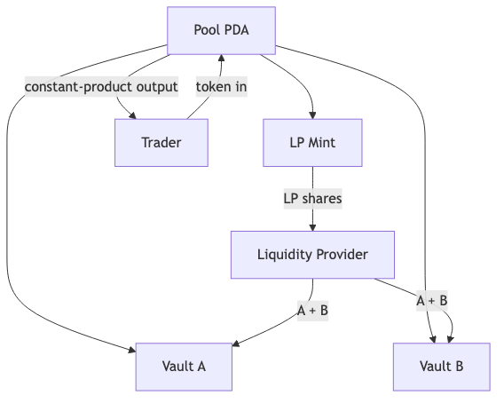
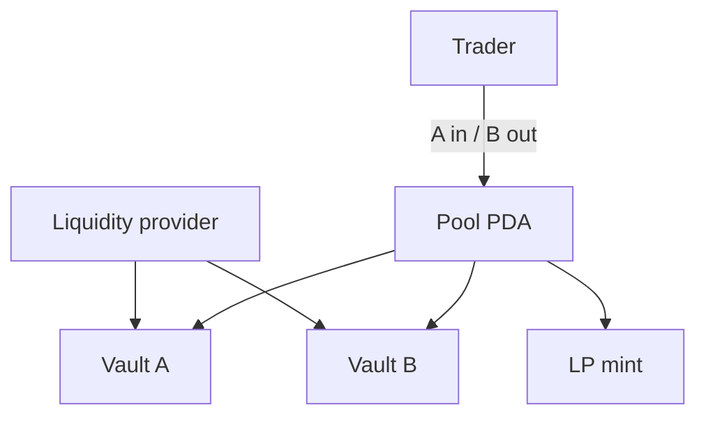

# Simple AMM / Stable Swap Lite

Bắt đầu bằng constant-product pool. Stable-swap và oracle là phần mở rộng khái niệm, không phải prerequisite của implementation chính.

Mã nguồn: [starter](./starter/README.md) → [checkpoint 1](./checkpoint-1/README.md) → [checkpoint 2](./checkpoint-2/README.md) → [final](./final/README.md).

## State

| Account | Seeds | Purpose |
| --- | --- | --- |
| Pool | `['pool', mint_a, mint_b, fee_bps (u16 LE)]` | mints, fee, bump |
| Vault A/B | ATA of pool PDA | token reserves |
| LP mint | `['lp', pool]`, authority = pool PDA | liquidity shares |
| Locked LP | `['locked_lp', pool]`, authority = pool PDA | `MINIMUM_LIQUIDITY` shares khóa vĩnh viễn |

## Instructions

- khởi tạo pool;
- thêm thanh khoản và mint LP share;
- rút thanh khoản và burn LP share;
- swap theo `x * y = k`, có fee và minimum output.

## Signer, writable và owner

| Write path | Signer | State mutable | Kiểm tra quan hệ quan trọng |
| --- | --- | --- | --- |
| `initialize_pool` | payer | Pool, vault A/B, LP mint, locked LP | canonical mint order; fee thuộc fee tier cho phép (5/30/100 bps); vault/LP authority là Pool PDA |
| `add_liquidity` | provider | vault A/B, LP mint, provider accounts | đúng mint/vault; shares theo reserve hiện tại |
| `remove_liquidity` | provider | vault A/B, LP mint, provider accounts | burn LP trước khi Pool PDA trả token |
| `swap` | trader | input/output vault và trader token accounts | đúng direction, fee, `minimum_output` và checked math |

Pool do AMM Program sở hữu; vault, LP mint và user token accounts do SPL Token Program sở hữu.

## Các trạng thái

- `starter`: math worksheet và pool schema
- `checkpoint-1`: khởi tạo pool/vault
- `checkpoint-2`: thêm/rút thanh khoản
- `final`: swap, slippage, test và ghi chú stable-swap/oracle

## Test bắt buộc

Kiểm thử lần thêm thanh khoản đầu tiên và tiếp theo, rút theo tỷ lệ, invariant, làm tròn fee, từ chối slippage, sai mint/vault, input bằng không và checked arithmetic.

## Tài nguyên sơ đồ

[Mở Mermaid source](../../notes/images/amm-flow.mmd) để chỉnh sửa sơ đồ.
