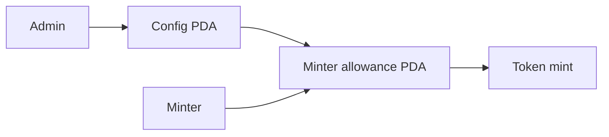

# Stablecoin Lite

Protocol token giáo dục có admin, roles, pause, mint/burn và Token-2022 concepts; đây không phải hạ tầng stablecoin production.

Mã nguồn: [starter](./starter/README.md) → [checkpoint 1](./checkpoint-1/README.md) → [checkpoint 2](./checkpoint-2/README.md) → [final](./final/README.md).

[Mermaid source](../../notes/images/stablecoin-flow.mmd)

## State

| Account | Seeds | Fields |
| --- | --- | --- |
| Config | `['config', mint]` | admin, paused, mint, total cap |
| Minter allowance | `['minter', config, minter]` | minter, remaining allowance |

## Instructions

- initialize configuration;
- grant/revoke minter allowance;
- pause/unpause;
- authorized mint within allowance/cap;
- holder burn;
- optional freeze/force-transfer discussion, disabled by default.

## Signer, writable và owner

| Write path | Signer/authority | State mutable | External owner/program |
| --- | --- | --- | --- |
| `initialize_config` | admin; config PDA phải là mint authority | Config | System Program, Token Program |
| `set_minter` | Config admin | Allowance | System Program |
| `set_paused` | Config admin | Config | Stablecoin Lite Program |
| `authorized_mint` | minter | Allowance, Config, Mint, destination token account | Token Program qua checked CPI |
| `burn` | token holder | Mint, holder token account | Token Program qua checked CPI |

## Các trạng thái

- `starter`: config schema and threat model
- `checkpoint-1`: initialize and role management
- `checkpoint-2`: pause and authorized mint
- `final`: burn, logic tests, integration-test matrix và Token-2022 note

## Test bắt buộc

Admin/minter authorization, paused behavior, allowance exhaustion, cap boundary, wrong mint, burn accounting, and role revocation.
