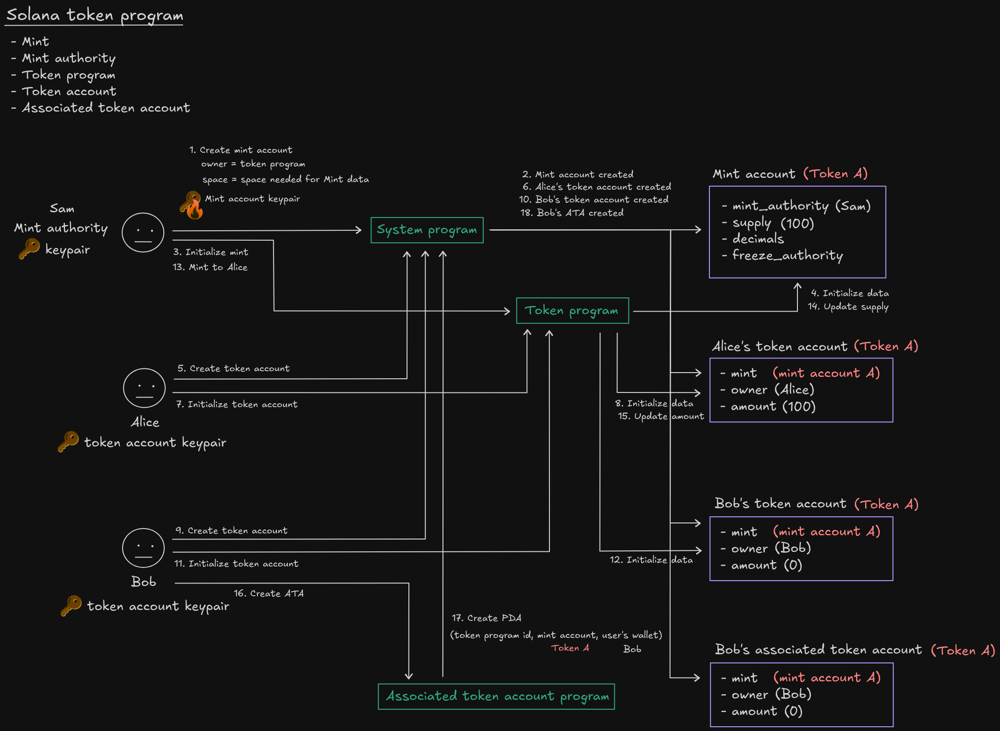
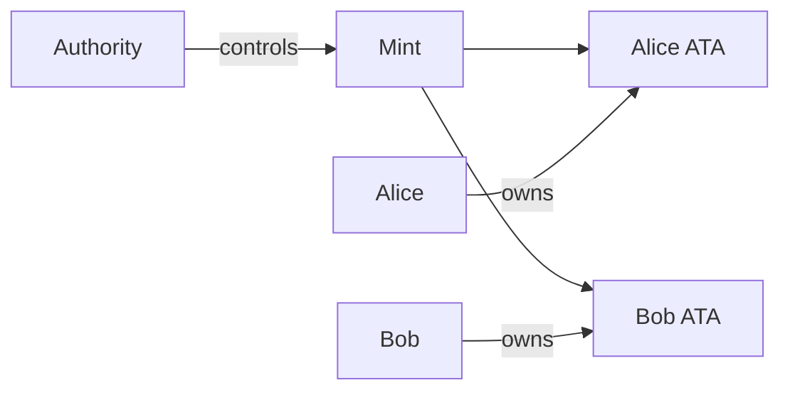

# SPL Token cơ bản

[Excalidraw source](../../notes/images/spl-token.excalidraw)

Lab client thực hành mint, token account, ATA, authority, mint, transfer và burn.

> Phần mã nguồn đã hoàn thiện đủ bốn trạng thái: [starter](./starter/README.md) → [checkpoint 1](./checkpoint-1/README.md) → [checkpoint 2](./checkpoint-2/README.md) → [final](./final/README.md).

## PDA rationale

Lab gọi SPL Token/Associated Token Program trực tiếp. ATA là địa chỉ deterministic chuẩn của owner/mint; project không cần custom program hoặc custom PDA.

## Quan hệ account

## Bài thực hành

1. Tạo mint với số decimals rõ ràng.
2. Derive và tạo hai ATA.
3. Mint một lượng cố định cho Alice.
4. Chuyển token sang Bob bằng `transferChecked`.
5. Burn token từ tài khoản của Bob.
6. Đọc balance và supply từ client.
7. Thu hồi mint authority và giải thích freeze authority.

## Các trạng thái

- `starter`: amount helpers và client còn TODO
- `checkpoint-1`: đã tạo mint và ATA
- `checkpoint-2`: đã mint và transfer
- `final`: burn, kiểm tra balance/supply, test và thu hồi authority

## Kiểm tra bắt buộc

- xác nhận đúng mint/owner trên mọi token account;
- dùng decimals được kiểm tra khi transfer/mint/burn;
- thao tác mint và burn trái phép phải thất bại;
- total supply bằng tổng account balances sau các thao tác.
