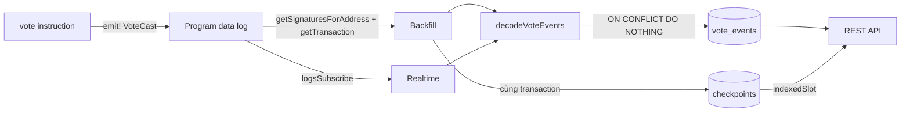

# Vote Indexer

Voting program phát event `VoteCast` mỗi lần vote; indexer TypeScript decode event từ log, lưu vào PostgreSQL theo khóa `(signature, event_index)`, backfill theo checkpoint, nghe realtime và mở REST API có phân trang giới hạn. Gõ lại từ đầu theo [code-along Module 13](../../curriculum/module-13-indexing/code-along.md).

## Data flow

Realtime chỉ chèn event; chỉ backfill, đi theo thứ tự lịch sử, mới tiến checkpoint. Indexer tắt rồi bật lại thì backfill bù phần bỏ lỡ, và khóa duy nhất chặn bản trùng khi hai đường chồng lấn.

## Event và schema

| Field `VoteCast` | Cột `vote_events` | Ghi chú |
| --- | --- | --- |
| — | `signature`, `event_index` | Khóa chính; `event_index` là thứ tự event trong transaction |
| — | `slot`, `block_time` | Lấy từ transaction, `block_time` có thể null |
| — | `program_id` | Program phát event |
| `version` | `version` | Tăng khi đổi schema event |
| `poll`, `candidate`, `voter` | cùng tên | Địa chỉ base58 |
| `candidate_id` | `candidate_id` | |
| `votes` | `votes` | Số phiếu của candidate sau lần vote này |
| `timestamp` | — | Giờ Clock trên chain; API dùng `block_time` |

Bảng `checkpoints(name, signature, slot)` giữ transaction cuối cùng backfill đã xử lý; `slot` không bao giờ lùi.

## REST API

| Endpoint | Tham số | Trả về |
| --- | --- | --- |
| `GET /polls/:poll/leaderboard` | — | `{ indexedSlot, items: [{ candidate, candidateId, votes }] }`, tối đa 100 dòng |
| `GET /polls/:poll/votes` | `limit` 1–100 (mặc định 20), `cursor` | `{ indexedSlot, items, nextCursor }`, mới nhất trước |

Poll sai định dạng, `limit` ngoài khoảng hoặc `cursor` hỏng trả `400`. `indexedSlot` cho frontend biết dữ liệu mới đến đâu.

## Ma trận test

| Tình huống | Test |
| --- | --- |
| Event phát đúng dữ liệu | `voting/tests/voting.ts`: vote phát event VoteCast |
| Decode event, bỏ log hỏng | `tests/decode.test.ts` |
| Nhận trùng một event | `tests/store.test.ts` |
| Checkpoint không lùi khi slot cũ đến sau | `tests/store.test.ts` |
| Lỗi giữa chừng không lưu nửa vời | `tests/store.test.ts` |
| Backfill bỏ transaction lỗi, chỉ lấy phần mới | `tests/ingest.test.ts` |
| Realtime và backfill chồng lấn | `tests/ingest.test.ts` |
| Leaderboard, phân trang, đầu vào sai | `tests/api.test.ts` |

## Giả định và giới hạn

- Đọc ở commitment `confirmed`: nhanh nhưng có thể bị rollback hiếm gặp; dữ liệu tiền bạc nên dùng `finalized` hoặc đối chiếu lại.
- Indexer là nguồn đọc dẫn xuất, không phải authority: muốn biết chắc số phiếu thì đọc account `Candidate` trên chain.
- RPC chỉ giữ lịch sử trong một khoảng; tắt indexer quá lâu thì backfill không còn dữ liệu để bù.
- Chưa xử lý đổi `version` của event, nhiều program, hay nhiều instance indexer chạy song song.

## Trạng thái

| Thư mục | Nội dung |
| --- | --- |
| [starter](./starter/README.md) | Điểm bắt đầu: project `voting` của Module 6 |
| [checkpoint-1](./checkpoint-1/README.md) | Decoder và fixture (hết bước 3) |
| [checkpoint-2](./checkpoint-2/README.md) | PostgreSQL, lưu idempotent, checkpoint (hết bước 5) |
| [final](./final/README.md) | Program có event, indexer đầy đủ |
