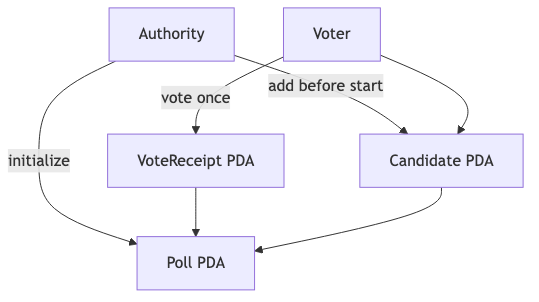
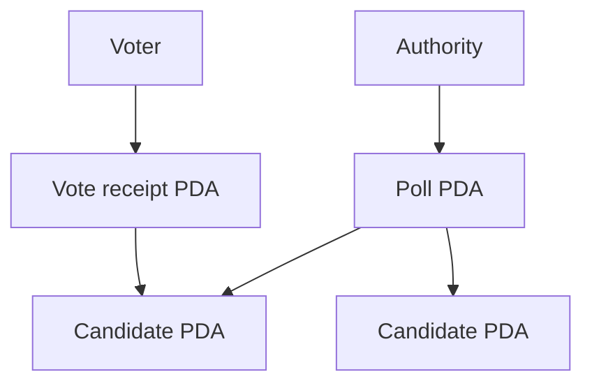

# Voting App

Tạo poll có time window, đăng ký candidate và ghi vote. Final dùng VoteReceipt để giới hạn một vote cho mỗi wallet/poll.

[Mermaid source](../../notes/images/voting-flow.mmd)

## Mô hình state

| Account | PDA seeds | Key fields |
| --- | --- | --- |
| Poll | `['poll', poll_id]` | authority, title, start/end, candidate count |
| Candidate | `['candidate', poll, name/hash]` | poll, name, votes |
| Vote receipt | `['vote', poll, voter]` | poll, voter, candidate |

## Instructions

| Instruction | Signer | Important validation |
| --- | --- | --- |
| `initialize_poll` | authority | start < end, bounded title |
| `add_candidate` | authority | poll authority, before start, unique PDA |
| `vote` | voter | poll active, candidate belongs to poll, no receipt |

## Signer, writable và owner

| Write path | Signer | State mutable | Owner/relationship |
| --- | --- | --- | --- |
| `initialize_poll` | authority | Poll | Voting Program; PDA theo `poll_id` |
| `add_candidate` | authority | Poll, Candidate | `poll.authority == authority`; Candidate thuộc Poll |
| `vote` | voter | Candidate, VoteReceipt | Candidate thuộc Poll; receipt theo Poll/Voter |

## Các trạng thái

- `starter`: state types and test descriptions
- `checkpoint-1`: poll creation
- `checkpoint-2`: candidates and PDA schemas
- `final`: voting, receipt, bộ integration tests và Voting Frontend reference

## Test bắt buộc

- poll and candidate creation;
- authority and time-window failures;
- correct vote count;
- candidate/poll mismatch rejection;
- duplicate vote rejection;
- frontend derives the same PDAs.
