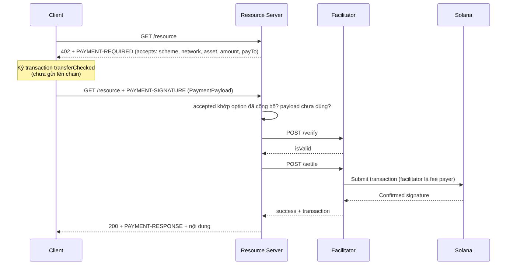
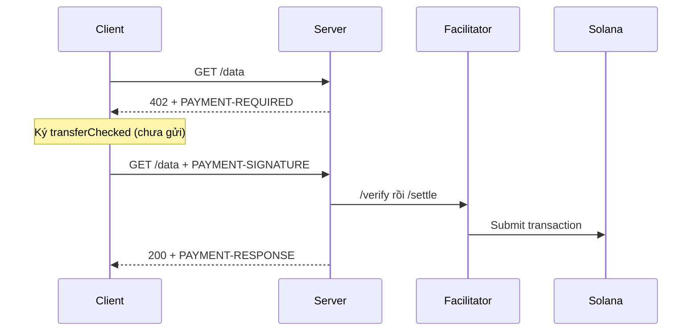

# x402 Paywall

Bảo vệ JSON data endpoint giáo dục bằng Devnet token micropayment.

Mã nguồn: [starter](./starter/README.md) → [checkpoint 1](./checkpoint-1/README.md) → [checkpoint 2](./checkpoint-2/README.md) → [final](./final/README.md).

## Thành phần

- `src/x402.ts`: lõi x402 v2 tự viết phía resource server (challenge, header, so khớp `accepted`, chống settle trùng, gọi facilitator), test offline;
- `src/server.ts`: resource server thật với `@x402/express` + facilitator, Solana Devnet;
- `src/client.ts`: paying client thật với `@x402/fetch` + `@x402/svm`;
- tests: 402 schema, payment hợp lệ, `accepted` sai, payload hỏng, verify fail, replay, đồng thời, timeout.

## Các trạng thái

- `starter`: types theo spec v2, các hàm còn TODO
- `checkpoint-1`: header base64, 402 challenge, so khớp `accepted`
- `checkpoint-2`: verify/settle qua `FacilitatorPort`, chống settle trùng, request đồng thời, timeout
- `final`: thêm server và client dùng SDK chính thức trên Devnet

## Security invariants

- `accepted` phải trùng một option server đã công bố (scheme, network, asset, amount, payTo);
- claim payload **trước** khi gọi facilitator để request đồng thời chỉ settle một lần;
- verify fail hoặc facilitator lỗi mạng thì nhả claim; settle đã có kết quả thì giữ claim;
- chỉ trả nội dung sau khi settle thành công.

## Trust boundary và mutable state

| Path | Authority/source | Mutable state | Không được tin trực tiếp |
| --- | --- | --- | --- |
| tạo challenge | resource server | không | không |
| gửi payment | paying client (ký transaction) | không | `accepted` client tự khai |
| verify/settle | facilitator | transaction lên chain | kết quả khi chưa có `success` |
| chống trùng | `SettlementCache` | payload đã claim (TTL 120s) | retry đồng thời cùng payload |

## PDA rationale

Không cần custom PDA: thanh toán là SPL `transferChecked` vào ATA của `payTo`. Cache chống trùng nằm sau `SettlementCache`; production có thể thay bằng Redis nhưng phải giữ claim nguyên tử.

## Test bắt buộc

- request đầu tiên trả 402 + `PAYMENT-REQUIRED` đúng schema;
- payment hợp lệ: verify → settle → 200 + `PAYMENT-RESPONSE`;
- `accepted` sai amount, payTo, asset hoặc network bị từ chối trước khi gọi facilitator;
- payload hỏng hoặc sai version trả `invalid_payload`;
- verify fail trả lý do của facilitator và không settle;
- replay và request đồng thời cùng payload chỉ settle một lần;
- facilitator timeout trả 502 retryable và cho retry cùng payload.

## Tài nguyên sơ đồ

[Mở Mermaid source](../../notes/images/x402-flow.mmd) để chỉnh sửa sơ đồ.
