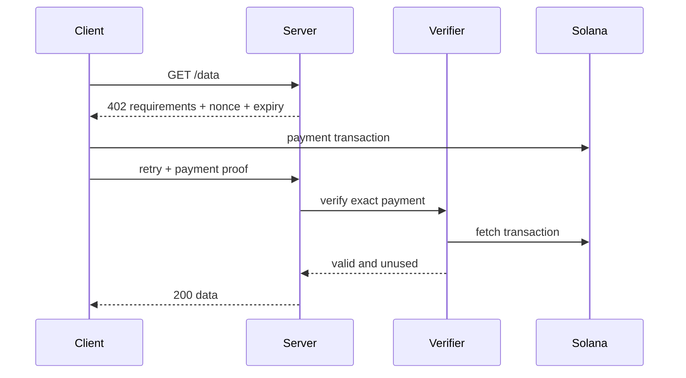

# x402 Paywall

Bảo vệ JSON data endpoint giáo dục bằng Devnet token micropayment.

Mã nguồn: [starter](./starter/README.md) → [checkpoint 1](./checkpoint-1/README.md) → [checkpoint 2](./checkpoint-2/README.md) → [final](./final/README.md).

## Thành phần

- resource server trả về 402 challenge;
- schema mô tả yêu cầu thanh toán;
- client tạo, ký thanh toán và gửi lại request;
- verifier/facilitator xác nhận settlement chính xác;
- replay store cho nonce/idempotency;
- test success, proof không hợp lệ, replay, expiry và concurrency.

## Các trạng thái

- `starter`: endpoint và challenge types
- `checkpoint-1`: 402 response và paying client
- `checkpoint-2`: onchain verifier và replay store
- `final`: rate limit, concurrency test và client cho agent

## Security invariants

Xác minh network, asset, amount, recipient, memo/nonce, expiry, confirmation, transaction thành công và tính single-use. Không tin một signature string nếu chưa kiểm tra transaction đã confirm.

## Trust boundary và mutable state

| Path | Authority/source | Mutable state | Không được tin trực tiếp |
| --- | --- | --- | --- |
| tạo challenge | resource server | nonce + expiry | client-supplied requirements |
| submit proof | paying client | chưa consume nonce | signature string |
| verify | verifier + RPC adapter | proof status | unconfirmed/failed transaction |
| settle | replay store | nonce chuyển sang used | retry đồng thời hoặc proof đã dùng |

## PDA rationale

Mock/local verifier không cần custom PDA: replay state nằm sau `ReplayStore` interface. Adapter production có thể thay bằng durable database hoặc receipt program nhưng không được thay đổi verification contract.

## Test bắt buộc

- request đầu tiên trả về đầy đủ yêu cầu 402;
- thanh toán hợp lệ và chính xác mở khóa resource;
- sai network, asset, amount hoặc recipient phải thất bại;
- proof hết hạn hoặc bị replay phải thất bại;
- transaction chưa confirm hoặc thất bại không được chấp nhận;
- các retry đồng thời chỉ tạo một kết quả kinh tế;
- verifier/RPC timeout trả về response có thể retry mà không đánh dấu payment đã dùng.

## Tài nguyên sơ đồ

[Mở Mermaid source](../../notes/images/x402-flow.mmd) để chỉnh sửa sơ đồ.
