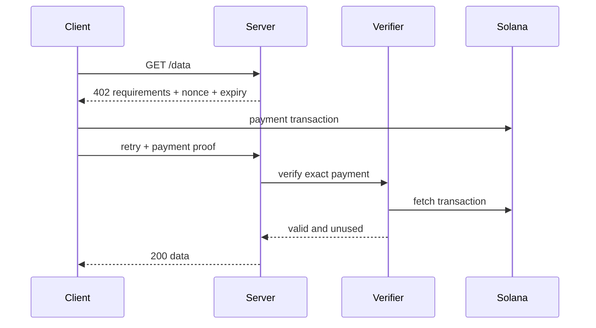

# x402 Paywall

Bảo vệ JSON data endpoint giáo dục bằng Devnet token micropayment.

[Mermaid source](../../notes/images/x402-flow.mmd)

Mã nguồn: [starter](./starter/README.md) → [checkpoint 1](./checkpoint-1/README.md) → [checkpoint 2](./checkpoint-2/README.md) → [final](./final/README.md).

## Thành phần

- resource server returning a 402 challenge;
- payment requirements schema;
- client that constructs/signs payment and retries;
- verifier/facilitator that confirms exact settlement;
- replay store for nonce/idempotency;
- tests for success, invalid proof, replay, expiry, and concurrency.

## Các trạng thái

- `starter`: endpoint and challenge types
- `checkpoint-1`: 402 response and paying client
- `checkpoint-2`: onchain verifier and replay store
- `final`: rate limits, concurrency tests, agent-facing client

## Security invariants

Validate network, asset, amount, recipient, memo/nonce, expiry, confirmation, transaction success, and single use. Never trust a signature string without inspecting the confirmed transaction.

## Trust boundary và mutable state

| Path | Authority/source | Mutable state | Không được tin trực tiếp |
| --- | --- | --- | --- |
| tạo challenge | resource server | nonce + expiry | client-supplied requirements |
| submit proof | paying client | chưa consume nonce | signature string |
| verify | verifier + RPC adapter | proof status | unconfirmed/failed transaction |
| settle | replay store | nonce chuyển sang used | retry đồng thời hoặc proof đã dùng |

## PDA rationale

Mock/local verifier không cần custom PDA: replay state nằm sau `ReplayStore` interface. Adapter production có thể thay bằng durable database hoặc receipt program nhưng không được thay đổi verification contract.

## Test bắt buộc

- initial request returns complete 402 requirements;
- exact valid payment unlocks the resource;
- wrong network, asset, amount, or recipient fails;
- expired and replayed proof fails;
- unconfirmed or failed transaction fails;
- concurrent retries return one economic result;
- verifier/RPC timeout produces a retryable response without marking payment used.
